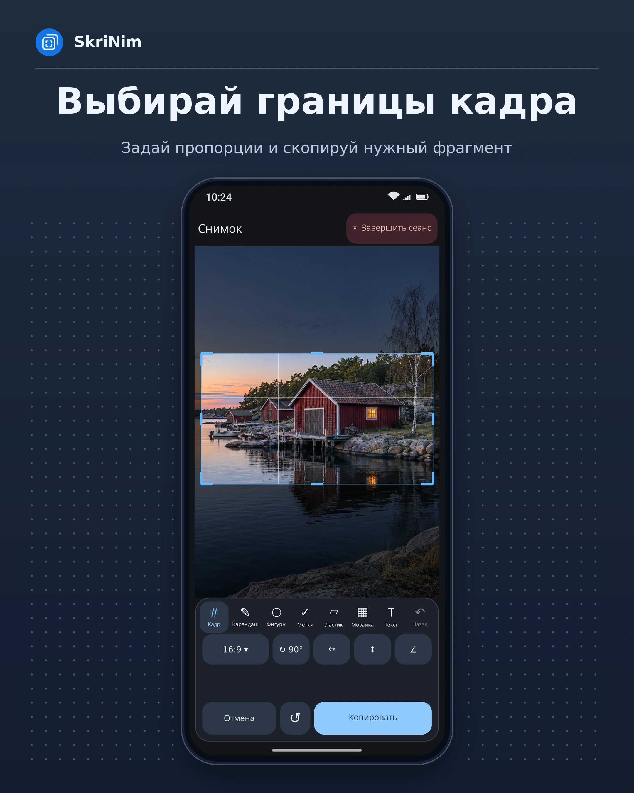

# SkriNim

Сними, отредактируй и вставь скриншот прямо в чат. По умолчанию он остаётся вне галереи. Если снимок нужен надолго, нажми значок сохранения в левом верхнем углу редактора.

**[Скачать стабильную версию для Android](https://github.com/MrBogomoll/SkriNim/releases/latest)** · Android 12 и новее · [Все версии](https://github.com/MrBogomoll/SkriNim/releases)

> При переходе с публичной 1.0 на 1.1.0 один раз удали 1.0 и установи новый APK. Для следующего обновления подойдёт установка поверх 1.1.0.

## Что можно сделать со снимком

- **Оставить нужный фрагмент.** Потяни за края рамки или выбери пропорции, например 1:1 или 16:9. Снимок можно повернуть, отразить или слегка выровнять.
- **Показать, куда нажать.** Укажи на кнопку стрелкой, обведи пункт меню или расставь номера шагов. Рядом можно поставить подпись или выноску.
- **Закрыть часть изображения.** Проведи кистью мозаики по участку снимка. В режиме «Только текст» кисть затрагивает распознанные слова. Если в кадр попал пароль, лучше вырезать его или закрыть сплошной непрозрачной фигурой.
- **Снять длинную страницу.** Запусти прокрутку из редактора вверх или вниз. Кнопка «Стоп» завершает захват, а стрелки в редакторе позволяют его продолжить.

  
  

  
  

## Первый снимок

Для Android 12 и новее. При запуске сеанса Android запрашивает разрешение на захват. На устройствах с поддержкой выбора области можно указать одно приложение или весь экран. В режиме одного приложения снимай, пока выбранное окно открыто. В кадр попадёт содержимое приложения без системной шторки и уведомлений. Чтобы выбрать другое приложение, останови сеанс и запусти его снова. Сеанс также заканчивается при выключении экрана. Плитка и плавающая кнопка снимают один кадр. В редакторе можно включить автоматическую прокрутку вверх или вниз для длинного снимка. Захват и редактирование работают без интернета. Снимки не отправляются в сеть.
Светлая тема включена по умолчанию. На главном экране в разделе «Тема» можно выбрать тёмную; выбор запоминается и действует на редактор.
В разделе «Автоотключение» можно включить завершение захвата после паузы. По умолчанию оно выключено. Доступны 30 секунд, 1, 2 и 5 минут или свой интервал. Успешный снимок сбрасывает отсчёт; новый сеанс после автоостановки снова требует разрешения Android.

1. Установи APK и добавь плитку «SkriNim» из приложения или через редактор шторки.
2. Нажми «Начать сеанс». В системном окне выбери «Показать приложение» и укажи нужное приложение либо выбери «Показать весь экран». Если после перехода Android отложит запуск, SkriNim подскажет нажать плитку или вернуться в приложение. Это запустит сеанс с уже сделанным выбором.
3. Перейди в приложение, нажми плитку. После возвращения фокуса и короткой паузы откроется редактор. Потяни за углы или стороны рамки, затем нажми «Копировать». «Отмена» закрывает текущий снимок и не трогает буфер. «× Завершить сеанс» закрывает редактор, останавливает захват и не трогает буфер.
4. Вставь скопированный снимок в чат. Чтобы сохранить его на устройстве, нажми значок сохранения до копирования. В альбоме «Скриншоты» появится PNG с выбранной областью и разметкой. По окончании останови захват системной кнопкой или кнопкой в приложении.

### Длинный снимок с прокруткой

1. Сделай обычный снимок открытой страницы плиткой или плавающей кнопкой. Если страница ещё движется после свайпа, SkriNim с включённой службой прокрутки ненадолго ждёт, пока движение утихнет.
2. Для автоматической прокрутки разверни исходное приложение на весь экран. В редакторе открой **«Кадр»**. Нажми **«Прокрутка вниз»**, чтобы добавить то, что ниже текущего экрана, или **«Прокрутка вверх»**, чтобы добавить то, что выше.
3. Автоматические свайпы выполняет служба специальных возможностей **«Прокрутка SkriNim»** (в отдельной бете — **«Прокрутка SkriNim Бета»**). Управлять разрешением можно на вкладке **«Настройки»** приложения. Если Android уже разрешил работу службы, повторное включение не требуется.
4. **«Стоп»** находится справа внизу поверх исходной страницы и доступен между свайпами. Нажми его в нужном месте или дождись границы страницы. Редактор откроет снимок с текстом в обычном порядке чтения.
5. Чтобы продолжить, оставь снимок открытым и снова нажми **«Прокрутка вниз»** или **«Прокрутка вверх»**. SkriNim ищет видимый фрагмент во всём собранном снимке. При смене направления приложение проходит уже снятый участок и добавляет новые строки, когда доходит до другого края.
6. Если страница успела уйти далеко от первого кадра, кнопка **«Начать здесь»** позволяет начать длинный снимок с видимого места. Если во время сборки возник разрыв, верни в кадр часть уже снятого текста или изображения и нажми **«Проверить»**. Кнопка **«В редактор»** открывает уже собранную часть.

Предел действует на весь снимок, включая повторную прокрутку. Максимальная высота — 16 384 пикселя. Она может быть меньше из-за ширины экрана и объёма памяти, выделенного Android. При достижении предела приложение показывает допустимую высоту в пикселях. Прокрутка также завершается при достижении края страницы или смене активного окна.

Если служба скрыта или недоступна, нажми **«Где найти?»** в подсказке о прокрутке. Кнопка **«О приложении»** открывает системные сведения именно об установленной версии SkriNim. Ограничение может находиться в разделе **«Расширенные настройки»** или в меню **⋮**. Для обычных снимков менять его не требуется.

Если в рамке видна шторка, отмени копирование. Если Android предупреждает об опасном APK, не отключай защиту для установки.

Беты нумеруются от текущей стабильной версии: после 1.0 идут `1.0.0_b.1`, `1.0.0_b.2` и далее. После выхода стабильной 1.1.0 следующая серия начинается с `1.1.0_b.1`. Для каждого нового APK увеличивай `versionCode` в AndroidManifest.xml. Имя APK берётся из `versionName`. Беты публикуются с отметкой GitHub Pre-release и устанавливаются вручную. Кнопка «Обновить» проверяет стабильные релизы. Android устанавливает обновление поверх предыдущей сборки при совпадающем идентификаторе приложения и совместимой подписи. Тестовые беты с отдельным идентификатором устанавливаются параллельно.

Сборка: Android Platform 35, Build Tools 35.0.0, Java и zip. В переменных ANDROID_JAR, ANDROID_TOOLS, APK_KEYSTORE и APK_KS_PASS укажи пути и способ передачи пароля для apksigner. При необходимости можно передать ECJ_JAR вместо javac. Запусти `bash build-apk.sh`.

В редакторе «Карандаш», «Овал» и «Стрелка» рисуют поверх снимка. «Назад» удаляет последнюю пометку. «Копировать» переносит в буфер только содержимое рамки с пометками.

В режиме разметки можно выбрать один из шести цветов и настроить толщину вертикальным ползунком: выше — толще. Кружок показывает образец выбранного цвета и толщины, а число — диаметр линии в пикселях снимка. Выбранный стиль применяется к новым пометкам и запоминается для следующих снимков.

Кнопка с процентами открывает отдельный ползунок непрозрачности (0–100%). Оба ползунка открываются внутри редактора и размещаются над своей кнопкой, если хватает места. Непрозрачность применяется только к новым пометкам. При 0% невидимая пометка не добавляется.

«Ластик» стирает часть ранее нарисованной разметки и мозаики, не меняя оригинал. Его максимальный диаметр втрое больше, чем в 0.18; минимальный и сохранённый размер не меняются. «Мозаика» усредняет по блокам то, что видно на снимке после предыдущих правок (включая линии и другие мазки мозаики). Размер блока и диаметр кисти регулируются отдельно, через «Блок … px» и «… px». Слабая пикселизация может оставлять текст и детали читаемыми; не используй её как надёжный способ скрыть настоящие пароли.

Завершённые правки хранятся в готовом слое в памяти. Во время рисования обрабатывается только текущий мазок, история перечитывается при отмене.

В «Кадр» доступны свободная обрезка, исходные пропорции, 1:1, 4:3, 3:4, 16:9, 9:16, 3:2, 2:3, 4:5, 5:4, 21:9 и 9:21, поворот по часовой на 90° и два отражения. Скриншот, рамка и разметка поворачиваются вместе. Четыре поворота возвращают исходную ориентацию. В «Карандаше» лежат свободная линия, прямая и стрелка. В «Фигурах» лежат овал, прямоугольник, круг, квадрат и сердечко.

Пропорции, фигуры, метки и подинструменты карандаша можно выбирать двумя способами: нажать кнопку и затем нужный пункт либо удержать кнопку, провести до пункта и отпустить. Отпускание вне пунктов закрывает меню без изменения.

Пипетка берёт цвет видимого пикселя, включая уже нанесённую разметку, не меняя настройку непрозрачности. Радужная кнопка открывает цветовой круг с яркостью и полями HEX/RGB.

При активной пипетке проведи пальцем по снимку: лупа покажет цвет под пальцем и соседние пиксели, а отпускание выберет отмеченный цвет. Во всех режимах редактирования можно раздвигать, сводить и перемещать два пальца для приближения и сдвига вида, не меняя кадр или разметку.

Под палитрой можно переключать «Контур» и «Заливку» для выбранной фигуры. Заливка рисует всю фигуру выбранным цветом с текущей непрозрачностью; толщина линии в этом режиме не используется. Переключатель влияет только на новые фигуры.

Выбери фигуру, затем под палитрой настрой жест: от края до края, от центра наружу или от края к центру. По умолчанию круг рисуется от центра, остальные фигуры — от края до края. Все три настройки запоминаются отдельно для каждой фигуры.

В «Мозаике» включи «Только текст», дождись поиска и проведи кистью по нужным словам. Распознавание идёт локально. Основной проход ищет русский и английский текст, как в 0.22. Дополнительный проход ищет цифры, не заменяя уже найденных слов. Ручного выбора языка нет. Все модели уже в APK, скачивать ничего не надо. Кисть меняет только области затронутых распознанных слов, не закрашивая остальную область мазка. Если слова не найдены или что-то пропущено, отключи этот режим и используй обычную мозаику. Для паролей и других секретов используй обрезку или непрозрачную заливку: распознавание может пропустить текст, и мозаика не гарантирует его сокрытие.

При первой сборке скрипт загружает Tesseract4Android 4.9.0 и модели tessdata_fast 4.1.0 для шести встроенных языков (нужны curl, unzip и sha256sum). Файлы проверяются по SHA-256 и сохраняются в build/ocr-cache, либо в каталоге OCR_CACHE_DIR. На телефоне интернет используется только по запросу для проверки и загрузки обновлений. Лицензии компонентов в assets/licenses.

В «Кадре» кнопка ∠ открывает плавный наклон от −45° до +45°. Снимок поворачивается под неподвижной по углу рамкой. Рамка остаётся внутри снимка, чтобы при копировании не было пустых углов. Быстрый поворот на 90° и отражения по-прежнему доступны.

В «Фигурах» есть ромб. У квадрата жест идёт через середины сторон, у ромба — через вершины. Под палитрой доступно «По осям / Свободно» для всех фигур, кроме круга, у которого поворот ничего не меняет. В свободном режиме овал и прямоугольник следуют за направлением жеста с пропорцией 3:2. Контур и заливка работают в обоих режимах.

Чтобы добавить подпись, включи «Текст» и коснись снимка. Рамка появится на месте касания. Двойное касание внутри рамки открывает клавиатуру поверх снимка, не меняя масштаб холста. «Готово» завершает ввод без применения; перетаскивание за середину двигает рамку. Боковые грани изменяют рамку и переносы, углы поворачивают. Размер шрифта и выбор переноса находятся в нижней панели. После «✓ Применить» подпись становится разметкой, её можно стереть или отменить как другие пометки.

В разделе «Фигуры» можно выбрать «Выноска». Её текст редактируется так же. Перетащи синюю точку наконечника в нужное место; при движении, повороте и изменении размеров рамки точка на снимке не смещается.

Галочка, крестик и номер шага находятся в отдельном разделе «Метки». Коснись снимка: метка встанет ровно по осям в точке касания, без сетки и привязки. Середина свободно перемещает метку, углы меняют масштаб без растягивания, круглая ручка поворачивает. В рамке доступны цвет, пипетка, круг, непрозрачность и толщина галочки или крестика; для номера меняется жирность цифры. Номер увеличивается только после применения видимой метки.

На вкладке «Снимок» доступны захват и плитка. На вкладке «Настройки» доступны тема, автоотключение и версия приложения. Нажми «Обновить», чтобы сравнить установленную версию с последним стабильным релизом. Если доступна новая версия, нажми «Скачать APK». SkriNim скачает файл, проверит его по SHA-256 и предложит «Установить». Android может попросить разрешить установку из этого источника. Если у релиза нет подходящего APK с контрольной суммой, можно открыть его страницу на GitHub.

Во вкладке «Настройки» можно отдельно включить «Плавающую кнопку». Если Android запросит разрешение, включи показ поверх приложений. Кнопка доступна во время запущенного сеанса, в том числе на обеих вкладках SkriNim. Удержание открывает вкладку «Настройки», перетаскивание меняет положение кнопки. В редакторе и во время запроса разрешения кнопки нет. Касание сначала скрывает кнопку, затем берёт новый кадр и открывает тот же редактор. Плитка в шторке остаётся доступной.

Размер и перенос текста размещены в нижнем блоке. Если редактор уже открыт, повторный вызов возвращает к незавершённой правке, а не создаёт второй снимок. Таймер захвата продолжает работать отдельно.

Максимальный размер шрифта и текста выноски увеличен в пять раз. Размер нижней карточки одинаков для всех инструментов, кадрирования и черновиков. В очень низком окне её кнопки можно прокрутить внутри карточки.

Палитра, пипетка и непрозрачность доступны в рамке текста и выноски, в том числе при открытой клавиатуре. Они меняют текущую подпись до применения.

Кнопки B, I, U и S задают жирный, курсив, подчёркивание и зачёркивание для всей текущей подписи или выноски. Стили можно сочетать.

Когда включена «Рамка» для фигуры, цвет, пипетка, цветовой круг, непрозрачность и контур/заливка доступны до применения. Толщина контура задаётся в пикселях снимка и не меняется при растягивании рамки.

Перед установкой метки нажми «Старт: авто» и введи ширину в пикселях снимка. Например, крестик с настройкой 20 px начинается с размера 20×20 px. Галочка сохраняет пропорции, номер шага остаётся круглым. Настройка общая для новых меток и запоминается; «Авто» возвращает размер, зависящий от снимка. Углы рамки меняют размер отдельной метки без изменения настройки.

## Лицензия

Код SkriNim распространяется по лицензии [MIT](LICENSE). Условия для встроенных сторонних компонентов перечислены в [уведомлениях о лицензиях](assets/licenses/NOTICE.txt).
