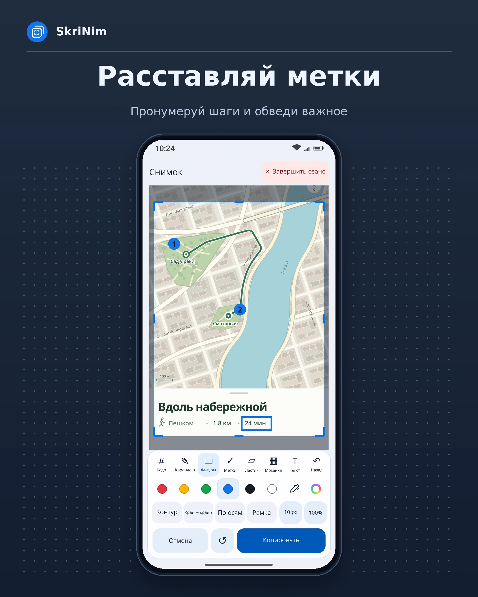

# SkriNim

SkriNim делает снимки экрана на Android без автоматического сохранения в галерею. Нажми плитку в шторке или плавающую кнопку, обрежь кадр, добавь стрелку и вставь результат в чат. Длинную страницу можно снять с прокруткой, а готовое изображение — сохранить как PNG.

**[Скачать стабильную версию для Android](https://github.com/MrBogomoll/SkriNim/releases/latest)** · Android 12 и новее · [Все выпуски](https://github.com/MrBogomoll/SkriNim/releases)

Если установлена публичная версия **1.0**, для перехода на серию 1.1.x один раз удали старое приложение и установи новый APK.

## В редакторе

Кадрируй снимок, поворачивай его или выбирай пропорции. Стрелки, фигуры, подписи и номера шагов помогают объяснить, куда нажать. Кистью мозаики можно обработать весь участок или только распознанные слова. Распознавание и редактирование работают на устройстве без интернета.

Кадрирование и разметка в версии 1.0.

  
  

  
  

## Первый снимок

1. Установи APK. На вкладке **«Снимок»** нажми **«Добавить плитку»** или добавь SkriNim через редактор плиток в шторке.
2. Нажми **«Начать сеанс»** и подтверди системный запрос на захват экрана.
3. Открой нужное приложение и нажми плитку **SkriNim**. В редакторе потяни за края рамки и добавь пометки. Если пользуешься плавающей кнопкой, ею тоже можно вызвать редактор.
4. Нажми **«Копировать»** и вставь результат в чат, который поддерживает вставку изображений. Для отправки позже нажми **значок сохранения** в левом верхнем углу редактора до копирования. PNG появится в альбоме «Скриншоты».

В системном буфере хранится ссылка на последний скопированный снимок. Она работает, пока процесс SkriNim держит снимок в памяти. После завершения процесса или копирования следующего снимка прежняя ссылка перестаёт открываться.

## Длинный снимок

В **«Настройки → Прокрутка»** разреши службу «Прокрутка SkriNim». Разверни исходное приложение на весь экран и сделай обычный снимок. В редакторе открой **«Кадр»**, выбери **«Прокрутка вниз»** или **«Прокрутка вверх»**. Чтобы вернуться в редактор с собранной частью, нажми **«Стоп»**.

Сначала собери всю страницу, затем обрезай и размечай. Прокрутку можно продолжить в обе стороны. Успешное продолжение заменит кадр вместе с текущими правками. [Если страница сдвинулась или прокрутка недоступна](docs/guide.md#длинная-страница)

## Обновления

Нажми **«Настройки → О приложении → Обновить»**. SkriNim сравнит версии с последним стабильным выпуском. Если доступно обновление, выбери **«Скачать APK»**, затем **«Установить»**. Перед установкой приложение сверяет файл и подпись. Если APK подписан несовместимым ключом или прямая загрузка недоступна, можно открыть страницу релиза на GitHub.

Стабильная версия предлагает только стабильные обновления. Беты устанавливаются вручную. Бета с тем же идентификатором приложения и совместимой подписью может обновиться до следующего стабильного патча. Отдельная тестовая бета с другим идентификатором устанавливается рядом со стабильной версией.

[Справка по редактору и настройкам](docs/guide.md) · [Сборка из исходников](docs/build.md) · [Лицензия MIT](LICENSE) · [Лицензии компонентов](assets/licenses/NOTICE.txt)
