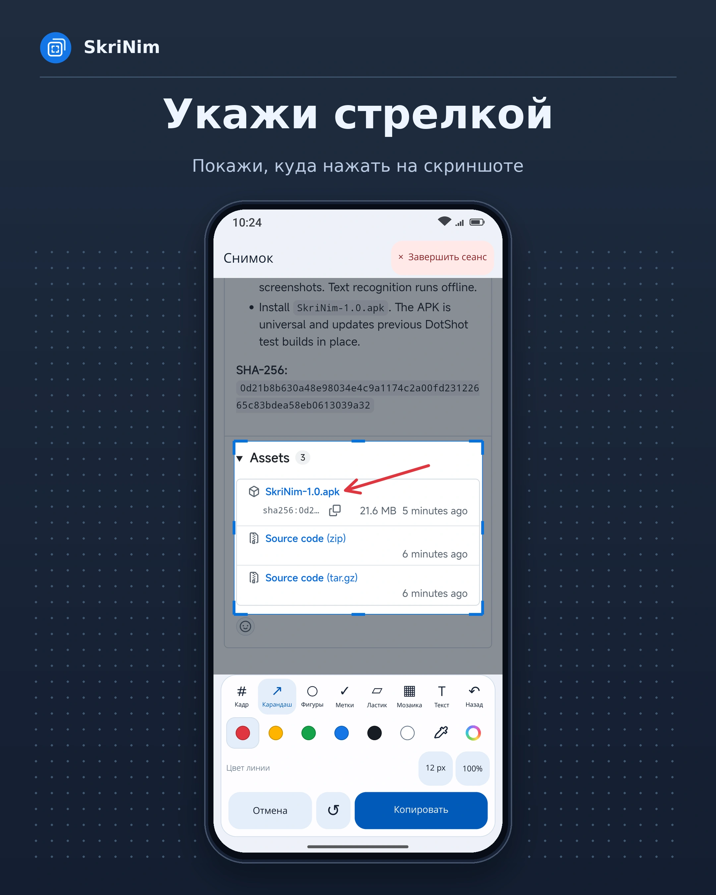
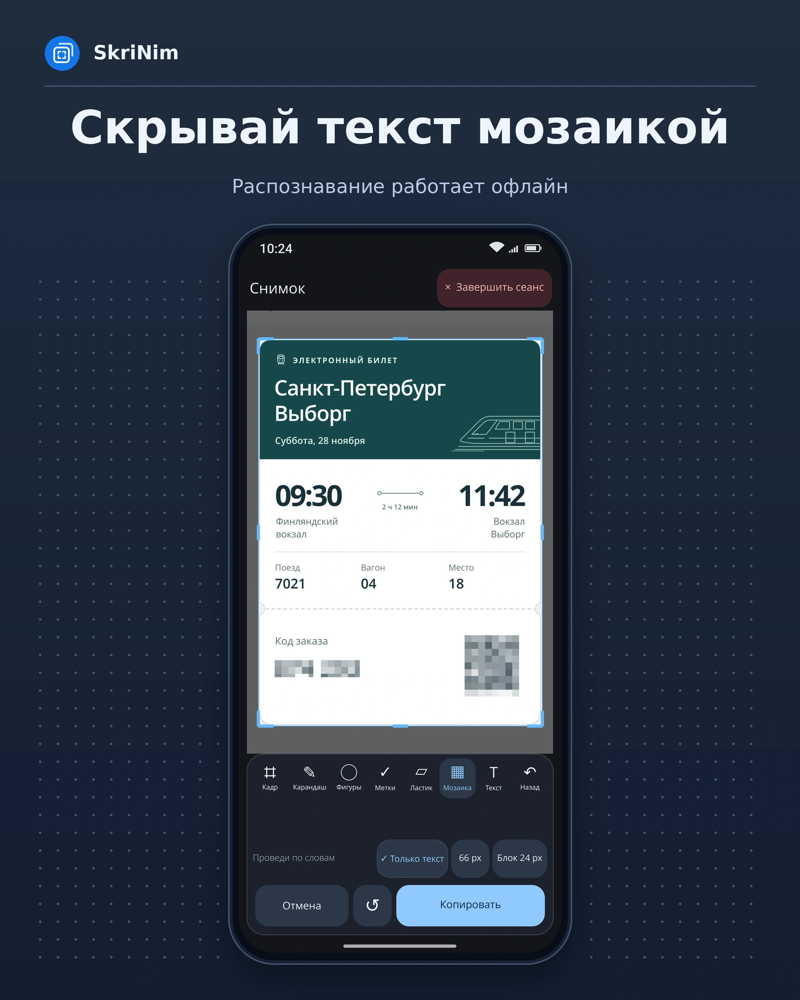

# SkriNim

SkriNim — редактор скриншотов для Android. Сними экран поверх открытого приложения, обрежь лишнее и отметь нужное место. Готовый фрагмент сразу попадает в буфер обмена: его можно вставить в переписку без сохранения в галерею.

**[Скачать SkriNim 1.0 для Android](https://github.com/MrBogomoll/SkriNim/releases/download/v1.0/SkriNim-1.0.apk)** · Android 12 и новее · [Все версии](https://github.com/MrBogomoll/SkriNim/releases)

## Что можно сделать со снимком

- **Оставить нужный фрагмент.** Потяни за края рамки или выбери пропорции, например 1:1 или 16:9. Снимок можно повернуть, отразить или слегка выровнять.
- **Показать, куда нажать.** Укажи на кнопку стрелкой, обведи пункт меню или расставь номера шагов. Рядом можно поставить подпись или выноску.
- **Закрыть часть изображения.** Проведи кистью мозаики по участку снимка. В режиме «Только текст» кисть затрагивает распознанные слова. Если в кадр попал пароль, лучше вырезать его или закрыть сплошной непрозрачной фигурой.

  
  

  
  

## Первый снимок

1. Установи APK и открой SkriNim. На вкладке **«Снимок»** добавь плитку **«Скрин в буфер»** в шторку Android. Если удобнее снимать одним касанием, включи **«Плавающую кнопку»** и разреши показ поверх приложений.
2. Нажми **«Начать сеанс»** и подтверди захват экрана. Если Android предложит выбрать область захвата, выбери **«Весь экран»**.
3. Открой то, что хочешь показать, и нажми плитку или плавающую кнопку. В редакторе выдели фрагмент, добавь пометки и нажми **«Копировать»**.
4. Перейди в чат или другое приложение с поддержкой вставки изображений и вставь снимок из буфера обмена.

## Как работает захват

Пока сеанс активен, можно сделать несколько снимков с одним разрешением Android. SkriNim берёт кадр только по нажатию. Редактирование и распознавание текста работают на устройстве без интернета.

Сеанс завершается при выключении экрана или по кнопке **«Остановить сеанс»**. В настройках можно включить автоотключение после паузы и выбрать светлую или тёмную тему.

Сборка из исходников и лицензии

Для сборки нужны Android Platform 35, Build Tools 35.0.0, Java, Bash, curl, zip, unzip и sha256sum. Укажи путь к `android.jar` в `ANDROID_JAR`, каталог Build Tools в `ANDROID_TOOLS`, путь к хранилищу ключей в `APK_KEYSTORE` и источник пароля для apksigner в `APK_KS_PASS`. Затем запусти `bash build-apk.sh`. При первой сборке скрипт скачает компоненты для распознавания текста и проверит их контрольные суммы.

[Лицензия кода SkriNim — MIT](https://github.com/MrBogomoll/SkriNim/blob/release/1.0.1/LICENSE) · [Лицензии сторонних компонентов](assets/licenses/NOTICE.txt)

